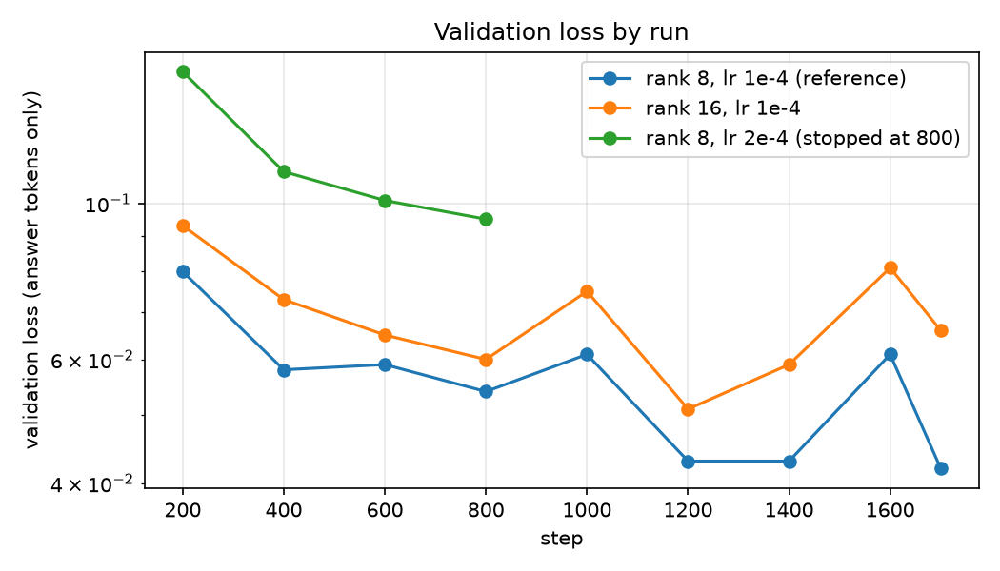

# Fine-tuning vs. prompting: extracting drug / adverse-effect pairs as JSON

An honest comparison of a LoRA-fine-tuned small model against the same model prompted, and against a 120B model prompted, on one narrow task, with measured accuracy, latency, memory and cost, including where fine-tuning did nothing or went wrong.

**TL;DR.** A Qwen2.5-3B (4-bit) fine-tuned with LoRA locally on a MacBook M4 (about 91 minutes, no cash cost) scored **pair-F1 0.733** on a held-out test set. gpt-oss-120b prompted with 4 examples scored **0.667** (difference **+0.066, 95% CI [+0.025, +0.108]**); the same 3B model prompted with 4 examples scored 0.581. But: single training seed; much of every model's error is span-boundary disagreement with noisy labels (a lenient overlap metric gives 0.899 vs 0.867); the API's cash cost for this task is only about $0.11 per 1,000 requests; and the base model's license is non-commercial. Details and failures below.

## Task and metric
Given one sentence from a medical case report, return JSON: `{"adverse_events": [{"drug": "...", "effect": "..."}]}` with every (drug, effect) pair.
Metrics were fixed before any result existed ([docs/task_spec.md](docs/task_spec.md)): **pair-level micro F1** (primary; exact match after lowercasing and whitespace normalization), JSON validity, sentence-level exact match, plus latency, memory and cost. Parsing is strict: chatty text around the JSON counts as invalid. This is a text-extraction exercise on public literature, **not medical advice**.

## Data
`ade-benchmark-corpus/ade_corpus_v2` (config `Ade_corpus_v2_drug_ade_relation`; Gurulingappa et al., 2012). 6,821 rows collapse to **4,271 unique sentences** (the corpus repeats a sentence once per pair, so a row-level split would leak). Grouped, then split by sentence with a fixed seed and an asserted leak check: **3,416 train / 427 validation / 428 test** (multi-pair sentences: 1,079 / 131 / 140). See [docs/data_card.md](docs/data_card.md). Gold labels are incomplete and inconsistent about span boundaries; that limits every score here.

## Method
- **Base model:** `mlx-community/Qwen2.5-3B-Instruct-4bit`, trained with MLX-LM on an Apple M4 (16 GB): LoRA on a 4-bit base, rank 8, scale 20, dropout 0.05, last 16 layers, batch 4, 1,700 steps (about 2 epochs), constant learning rate 1e-4 (no decay), loss on answer tokens only. Peak training memory about 11 GB (read from the W&B memory chart).
- **Baselines:** the same 3B model zero-shot and with 4 fixed training examples; **gpt-oss-120b** on Groq's free tier with the same 4 examples, temperature 0, `reasoning_effort=low`. Gemini was attempted but its free tier allows 20 requests per day per model, so a full evaluation was infeasible; it is excluded and that limit is itself a finding.
- **Discipline:** all tuning used the validation split. The test split was untouched until the protocol was frozen and tagged (`protocol-frozen`, [docs/eval_protocol.md](docs/eval_protocol.md)), then each model was scored once. The scorer was checked with an oracle file (must score 1.0) and a deliberately broken file before use.

## Results (test set, n = 428)
| Model (test, n=428) | JSON valid | Pair F1 | Precision / Recall | Exact match | Latency mean / p95 | Peak memory | Cost per 1,000 requests |
|---|---|---|---|---|---|---|---|
| Qwen2.5-3B, zero-shot (local) | 26.9% | 0.154 | 0.483 / 0.092 | 7.9% | 0.75s / 1.05s | 2.08 GB | $0 cash; ~$0.0009 electricity (assumed) |
| Qwen2.5-3B, 4-shot (local) | 91.1% | 0.581 | 0.662 / 0.518 | 42.5% | 1.41s / 1.93s | 2.33 GB | $0 cash; ~$0.0018 electricity (assumed) |
| gpt-oss-120b, 4-shot (Groq API) | 100.0% | 0.667 | 0.739 / 0.607 | 58.4% | 1.00s / 2.64s | n/a (hosted) | $0.112 (list price) |
| **Qwen2.5-3B + LoRA r8, short prompt (local)** | 99.8% | 0.733 | 0.747 / 0.720 | 66.8% | 1.03s / 1.76s | 2.15 GB | $0 cash; ~$0.0013 electricity (assumed) |
| Qwen2.5-3B + LoRA r8, 4-shot prompt (local) | 99.8% | 0.571 | 0.532 / 0.617 | 49.3% | 1.85s / 2.83s | 2.73 GB | $0 cash; ~$0.0023 electricity (assumed) |

Notes: single training seed. Local latency = M4 MacBook Pro, one request at a time. API latency includes network and shared free-tier queueing.
API cost = measured tokens x Groq list price ($0.15/M in, $0.6/M out); we paid $0 on the free tier. Electricity assumes 30 W and $0.15/kWh and ignores hardware cost.
Test-set F1 differences (paired bootstrap, 95% CI): LoRA vs gpt-oss-120b +0.066 [+0.025, +0.108]; LoRA vs 3B 4-shot +0.152 [+0.107, +0.198].

The fine-tuned model uses the short prompt it was trained on. Giving it the 4-shot prompt instead drops F1 from 0.733 to 0.571 (-0.162, 95% CI [-0.193, -0.129]): fine-tuning bakes in a prompt format, so serve it with that prompt.

## Other experiments (validation set, single seed)
| Experiment | Result |
|---|---|
| Checkpoints of the main run | F1 0.714 (step 400), 0.693 (600), 0.714 (800), 0.781 (1,200), 0.782 (1,600), 0.763 (1,700). Training past one epoch helped (+0.067, CI [+0.026, +0.103] from 800 to 1,200); validation loss barely moved over that range, so loss was a poor guide to F1. |
| Rank 16 vs rank 8 | F1 0.748 vs 0.763 (-0.016, CI [-0.053, +0.020]): no detectable benefit from doubling capacity. |
| Learning rate 2e-4 vs 1e-4, compared at step 800 | F1 0.615 vs 0.714 (-0.100, CI [-0.140, -0.061]): worse. The 2e-4 run was stopped at step 800 and not finished. |
| Fused adapter (merged into the 4-bit weights) | F1 0.774 vs 0.763 (+0.010, CI [-0.006, +0.028]): no meaningful change; mean latency 0.89 s vs 1.12 s. |

Curves: `results/val_loss_curves.png` (W&B was used for tracking, but the project may not stay accessible, so the evidence is committed).



## Where fine-tuning helped, did nothing, or hurt
Error analysis on the test set is **post-hoc**: categories come from string-matching heuristics and nothing was changed because of it ([results/error_examples.md](results/error_examples.md)).
- **Helped:** format reliability (99.8% valid JSON vs 91.1% for the 4-shot 3B), and multi-pair sentences (strict F1 0.680 vs 0.570 for the 120B, on 140 sentences). Recall is where it leads (0.720 vs 0.607); precision is equal (0.747 vs 0.739).
- **Did nothing:** single-pair sentences are about even with the 120B (0.788 vs 0.763; I did not test that gap). Span-boundary disagreements are the largest error class for every model (about 95 to 100 false positives and 99 to 126 false negatives each). Higher LoRA rank did not help.
- **Went wrong or cost something:**
  - *Memorization:* F1 0.914 on training sentences vs 0.733 on test.
  - *Prompt sensitivity:* see above.
  - *Behavior on unrelated prompts:* on a 40-question general sanity set the adapter scored 35/40, same as the base, but gave wrong or degenerate outputs (repetition loops, stray image links) on 4 short prompts the base answered correctly. 40 items detects only large regressions.
  - *Repetition loops:* a few outputs truncate mid-JSON.
- **The models err differently:** the fine-tuned model adds more pairs the annotators did not label (47 vs 19); the 120B skips more gold pairs (122 vs 67). Of 428 test sentences, 69 are exactly right only for the fine-tuned model, 33 only for the 120B, 109 for neither.
- **Strict vs lenient:** a lenient overlap metric (drug and effect each equal or contain the gold text) gives F1 0.899 (fine-tuned) vs 0.867 (120B) vs 0.757 (3B 4-shot). Part of the strict-metric lead is learning this dataset's labeling conventions, which is a different thing from being a better extractor. I did not bootstrap the lenient gap.

## Cost, latency, memory
- API cost for the 120B at Groq's list price ($0.15 / $0.60 per million input / output tokens, checked Nov 2026; some resellers list higher output prices): about **$0.11 per 1,000 requests** from measured tokens (we paid $0 on the free tier). A million requests would be roughly $110.
- Local model: no per-request cash cost; electricity is an *assumed* figure (30 W, $0.15/kWh) of about $0.001 per 1,000 requests. Hardware cost is ignored.
- Latency is a tie, not a win: mean 1.03 s local vs 1.00 s API (p95 1.76 s vs 2.64 s). API latency includes network and shared free-tier queueing. Local timings are one request at a time on one M4.
- Served locally with `mlx_lm.server` (fused model): 1.27 req/s sequential (p50 0.63 s, p95 1.48 s); 2.52 req/s with 4 concurrent requests (p50 1.39 s). I did not test beyond 4. The served endpoint reproduced the offline fused scores exactly.
- Inference memory about 2.15 GB; adapter file 25 MB; fused model 1.6 GB.

## When to fine-tune vs. when to just prompt (for this task, on this evidence)
- **Fine-tuning earned its place** when the output must follow dataset-specific conventions and there are a few thousand labeled examples: it beat the same small model's few-shot prompting by +0.152 F1 and removed most invalid JSON.
- **Cost alone was not the argument.** At this task's token footprint the prompted API is cheap in cash terms, so at low or moderate volume I would try better prompting first. Fine-tuning pays off through volume, no rate limits or API dependency (the free Gemini tier capped us at 20 requests per day), or data that cannot leave the machine, none of which I measured as dollars.
- **Prefer prompting** when labels are few, the schema changes often, or the prompted model is already within noise of your target.
- **Caveats on the comparison:** the 120B prompt used 4 fixed examples with no tuning, so better prompt engineering or retrieved examples could narrow the gap (untested); one seed; one dataset.
- **License:** Qwen2.5-3B-Instruct is under the Qwen Research License (non-commercial). This adapter cannot be used commercially as is; a real deployment would need a base model with a suitable license.

## Limitations
Single training seed (intervals only resample test sentences, not training randomness); constant learning rate with no decay; small hyperparameter exploration (rank 8 vs 16, lr 1e-4 vs 2e-4 at one step count); noisy gold labels; one dataset; free-tier API latency is noisy; electricity and hardware cost are not measured; the forgetting check is a 40-item smoke test.

## Next steps
Multiple seeds; learning-rate decay; retrieved or tuned few-shot examples for the large model; a base model with a commercial-friendly license; a human review of the "extra" pairs the fine-tuned model adds, to see how many are actually correct.

## Reproduce
```
python3.12 -m venv .venv && source .venv/bin/activate && pip install -r requirements.txt
python src/prepare_data.py                      # leak-free splits -> data/processed
PYTHONPATH=src python src/make_mlx_data.py      # chat-format training data
mlx_lm.lora --config configs/lora_r8.yaml       # about 91 min on an M4
PYTHONPATH=src python src/run_mlx.py --model mlx-community/Qwen2.5-3B-Instruct-4bit --adapter adapters/lora_r8 --split test --name lora_r8_zeroshot
python src/evaluate.py --gold data/processed/test.jsonl --pred results/preds_lora_r8_zeroshot_test.jsonl --name lora_r8_zeroshot_test
```
Baselines: `src/run_mlx.py` (add `--fewshot` for 4-shot) and `src/run_groq.py` (needs `GROQ_API_KEY` in `.env`). Paired bootstrap: `src/bootstrap.py`. Error analysis: `src/error_analysis.py`. Table: `src/make_table.py`. Serving demo: `mlx_lm.server` + `src/client_demo.py` + `src/bench_server.py`.

## Repo layout
`src/` code, `configs/` training configs, `docs/` task spec, data card, frozen protocol, demo script, `results/` metrics, raw predictions, logs, tables, `publish/` the Hugging Face upload folder.

## Links, licenses, data
- Adapter and model card: https://huggingface.co/aadityaa1/qwen25-3b-ade-lora-r8 (Qwen Research License, non-commercial; built with Qwen).
- The dataset card declares no license. Processed splits and predictions are included here for reproducibility; if you are a rights holder and want them removed, please open an issue.
- Gurulingappa, H., et al. (2012). Development of a benchmark corpus to support the automatic extraction of drug-related adverse effects from medical case reports. *Journal of Biomedical Informatics*.
